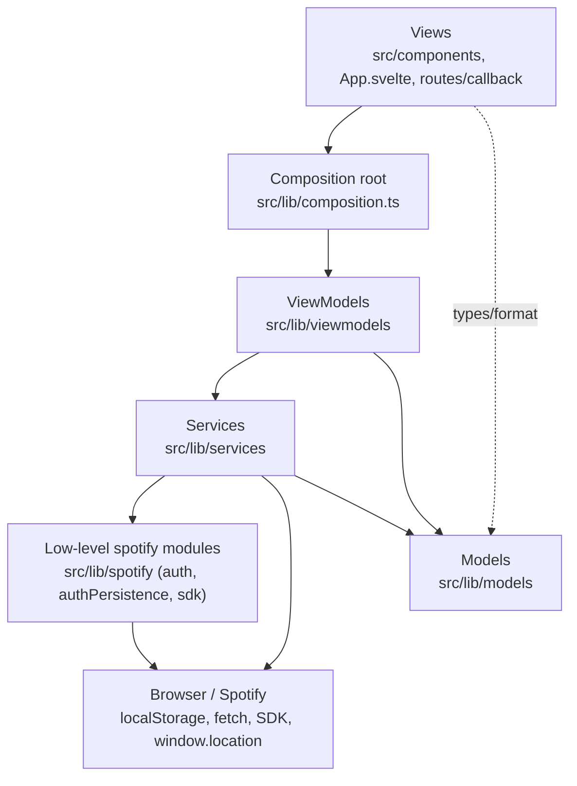
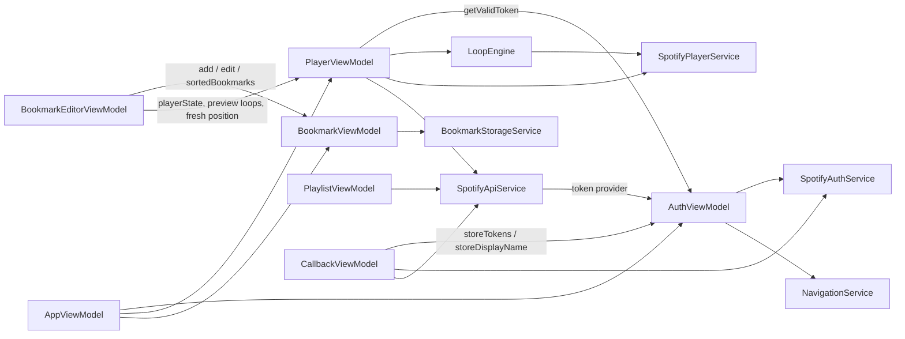

# 01 – Architecture

Practify is a client-only single-page app (Svelte 5, Vite, TypeScript). There is no backend: authentication is
OAuth 2.0 PKCE directly against Spotify, audio is played by the Spotify Web Playback SDK inside the browser tab
(Spotify Premium required), and bookmarks live in `localStorage`.

## Layers

| Layer | Responsibility | Rules |
| --- | --- | --- |
| **Playback** (`src/lib/playback/`) | `LoopEngine`: timers, position polling and loop enforcement, behind a small `PlaybackSource` interface | No Svelte, no stores; owned by `PlayerViewModel` |
| **Model** | Plain types and pure functions: `Bookmark`, `PlayerState`, `toLoopRegion`, `formatMs`/`parseMs`/`adjustMs`, Spotify DTO types | No framework, no browser APIs |
| **Service** | Wrap one external dependency each, behind an `I…Service` interface | Only layer that touches `fetch`, `localStorage`, the SDK, `window.location` |
| **ViewModel** | All state and business logic. `createXxxViewModel(deps)` returns stores plus action methods | Dependencies injected; no DOM; tested with fakes |
| **View** | `.svelte` components | Bind to ViewModel stores with `$store`, call ViewModel methods; no domain logic |

## ViewModels and their dependencies

`composition.ts` is the only place that instantiates services and ViewModels. Note the token provider cycle is
resolved there: `SpotifyApiService` is constructed with `() => authViewModel.getValidToken()`, so the service
never imports the ViewModel.

## Startup sequence

1. `main.ts` mounts `App.svelte`. Importing `$lib/composition` constructs all singletons. `AuthViewModel` loads any
   persisted tokens from `localStorage` synchronously, so the authenticated state is known before first render.
2. `App.svelte` branches on `appViewModel.isCallbackRoute` (true when the URL query contains `code` or `error`):
   - **Callback route** → renders `Callback.svelte`, whose `onMount` calls `callbackViewModel.completeLogin()`.
   - **Normal route** → renders the logged-in or logged-out layout based on `isAuthenticated`.
3. `onMount(appViewModel.start)` runs `AppViewModel.start()`:
   - **auth sync**: when authenticated (and not on the callback route) → `playerViewModel.init()`; on a transition to logged out → `playerViewModel.destroy()`, which also empties the track and therefore the shown bookmarks;
   - subscribes **track sync**: whenever the player's track changes, `bookmarkViewModel.showBookmarksForTrack(trackId)`;
   - subscribes **loop sync**: keeps the active loop consistent with bookmark edits/deletions (see doc 03);
   - returns a cleanup function (unsubscribe all, `playerViewModel.destroy()`), which Svelte calls on unmount.

There is no router. "Routing" is just the query-string check above; the OAuth redirect URI is configured as
`…/callback`, and the app is built with `--base=/practify/` for GitHub Pages deployment.

## Layouts

`App.svelte` renders a wide (`lg+`) and a narrow layout simultaneously and hides one with CSS. Both mount
instances of the same components against the same singleton ViewModels, which is why shared state (selected
playlist, editor form) is identical in both, and why loading is de-duplicated inside ViewModels
(`PlaylistViewModel.loadPlaylists` only fetches once).

## Testing approach

Unit tests live in `__tests__/` next to the code and target models, services and ViewModels using fakes and fake
timers (Vitest + jsdom). Components are not unit tested. `src/test-setup.ts` installs an in-memory `Storage`
because newer Node versions expose a global `localStorage` that shadows jsdom's.
