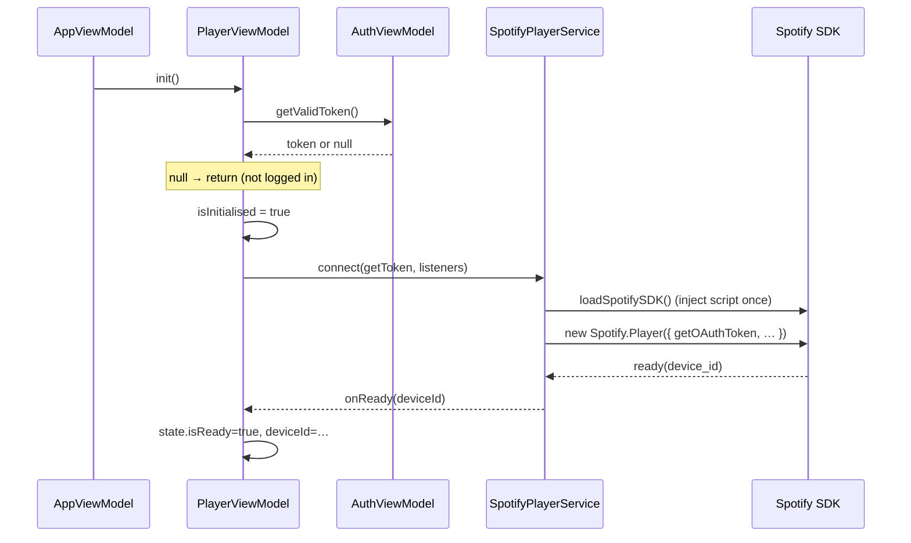

# 02 – Player and player state

Files: `viewmodels/PlayerViewModel.ts`, `playback/LoopEngine.ts`, `services/SpotifyPlayerService.ts`, `services/SpotifyApiService.ts`,
`models/player.ts`, `spotify/sdk.ts`.

## Two channels to Spotify

Playback is split across two separate mechanisms, and understanding that split explains most of the behavior:

| Channel | Used for | Implemented in |
| --- | --- | --- |
| **Web Playback SDK** (in-browser "device") | Reading playback state, `seek`, `pause`, `resume`, state-change events | `SpotifyPlayerService` |
| **Spotify Web API** (REST) | Starting a track on the SDK device: `PUT /me/player/play?device_id=…` with `{ uris: [uri] }` | `SpotifyApiService.startPlayback` |

The SDK registers the browser tab as a Spotify Connect device (name "Spotify Practice Tool", volume 0.8). The
SDK itself cannot start an arbitrary track, so the app asks the Web API to play a URI *on that device id*.
After that, control returns to the SDK.

## PlayerState

Defined in `models/player.ts`, held in a writable store inside `PlayerViewModel`, exposed read-only as
`playerState`.

| Field | Meaning | Written by |
| --- | --- | --- |
| `isReady` | SDK device is connected and usable | SDK `ready` / `not_ready` |
| `deviceId` | Id of the SDK device; required to start playback | SDK `ready` / `not_ready` |
| `track` | The track the user selected (`SpotifyTrack`) | `playTrack` |
| `positionMs` | Last known playback position | SDK state change, progress poll, loop poll |
| `durationMs` | Track length as reported by the SDK | SDK state change |
| `isPlaying` | `!paused` from the SDK | SDK state change |
| `activeLoop` | `{ id, startMs, endMs }` or `null` | `activateLoop` / `retimeActiveLoop` / `deactivateLoop` / track changes |
| `scrubPositionMs` | Position of the seek slider while the user drags it, else `null` | `scrubTo` / `commitScrub` |
| `connectionError` | Message when the SDK player cannot be used (load failure, account, authentication, initialization) | `init`, SDK error events |
| `playbackError` | Message for a failed play, seek or pause/resume, or an SDK playback error | `playTrack`, `seek`, `togglePlay`, SDK error events |

`track` is only committed once Spotify has accepted the request to play it, and it is reconciled with the track the
SDK reports (see below), so it follows what is actually playing. `positionMs`/`durationMs`/`isPlaying` come from the SDK.

`displayPositionMs` is a derived store: `scrubPositionMs ?? positionMs`. The seek slider and the elapsed-time label use it.

`loopRegion` is a derived store (`toLoopRegion`) giving `{ startPercent, widthPercent }` of the active loop
relative to `durationMs`, or `null` when there is no loop or no duration. The seek bar uses it to draw the green
overlay.

## Initialisation (`init`)

- `isInitialised` is set *before* awaiting `connect`, so concurrent `init()` calls cannot create two players.
- `getOAuthToken` passes through `AuthViewModel.getValidToken()`, so the SDK always gets a refreshed token.
- If `connect` fails (the script cannot load, or the SDK's `connect()` resolves `false`) `isInitialised` is reset and
  `connectionError` is set, so `init()` can be retried; the UI shows the message with a "Prøv igjen" button.
- The service forwards the SDK's `initialization_error`, `authentication_error`, `account_error` and `playback_error`
  events. The first three become `connectionError` (for example "Spotify Premium kreves…"), `playback_error` becomes
  `playbackError`.
- `AppViewModel` calls `init()` when the user is authenticated and `destroy()` when they log out, so logging out
  disconnects the player and stops all polling.
- `destroy()` disposes the loop engine (all timers), disconnects the SDK, resets `isInitialised` and the state.

## How position is known

The SDK does **not** stream position continuously. It emits `player_state_changed` on discrete events (play,
pause, seek, track change) with a position snapshot. To get a smooth position, `LoopEngine`
(`playback/LoopEngine.ts`) polls `getPlaybackSnapshot()` (the SDK's interpolated position) and reports it to the
ViewModel through an `onPosition` callback. The engine runs at most one of two pollers:

| Poller | Interval | Runs when | Does |
| --- | --- | --- | --- |
| **Progress poll** | `setInterval` 500 ms | `isPlaying` and **no** loop | Writes `positionMs` from non-paused snapshots |
| **Loop poll** | self-rescheduling `setTimeout` 100 ms | A loop is active | Writes `positionMs` and enforces the loop (doc 03) |

Event handling in `onPlaybackChanged(snapshot)`:

1. Write `positionMs`, `durationMs`, `isPlaying` to the state.
2. `loopEngine.setPlaying(!snapshot.isPaused)`, which starts or stops the progress poll as the rule above dictates.

The ViewModel no longer manages timers; deactivating a loop or pausing simply changes what the engine's rule
allows. `getCurrentPositionMs()` bypasses both pollers and asks the SDK for a fresh snapshot (it also writes the
value to `positionMs`); the bookmark editor uses it so captured timestamps are exact, not up to 500 ms stale.

## Commands

| Method | Behavior |
| --- | --- |
| `playTrack(track)` | Clears `playbackError`. Without a `deviceId` it sets a "not ready" error and changes nothing. Otherwise it records `pendingTrackId`, calls `startPlayback(deviceId, uri)`, and only on success stops the loop engine and sets `track` / clears `activeLoop`. On failure the previous track and loop stay and `playbackError` is set. |
| `togglePlay()` | If `isPlaying` → SDK `pause()`, else SDK `resume()`; failures set `playbackError` |
| `seek(ms)` | SDK `seek(ms)`; failures set `playbackError` instead of rejecting |
| `scrubTo(ms)` / `commitScrub(ms)` | Seek-slider dragging, see below |
| `getCurrentPositionMs()` | Fresh SDK position (falls back to the last known one when the SDK has no state) |
| `activateLoop` / `retimeActiveLoop` / `deactivateLoop` / `deactivatePreviewLoop` / `toggleLoop` | See doc 03 |
| `destroy()` | Disposes the engine, disconnects the SDK, resets state |

State is updated optimistically only where the ViewModel owns the fact (`track`, `activeLoop`). Playback facts
(`isPlaying`, position) are only ever taken from the SDK, never assumed after a command.

## Staying in sync with the SDK's real track

`PlaybackSnapshot` carries the SDK's `current_track` (mapped to a `SpotifyTrack`; episodes and local files give
`null`). On every state change `adoptTrackReportedBySdk` compares it with `state.track`:

- **Same id** → nothing.
- **Different id and no request pending** → the track changed outside the app's control (the single-track context ended,
  playback was transferred, another Spotify client took over). The engine's loop stops and `state.track` becomes the
  SDK's track with `activeLoop = null`; `AppViewModel` then switches the bookmark list to that track.
- **A requested track is pending** (`pendingTrackId` set by `playTrack` before the API call) → events about the old
  track are ignored; the first event whose id equals `pendingTrackId` clears the pending marker. This prevents the UI from
  flickering back to the old track while Spotify is switching. The marker is also cleared on failure and on `destroy`.

## Seek slider (scrubbing)

Dragging fires many `input` events. `scrubTo(ms)` sets `scrubPositionMs` (the thumb follows the pointer, ignoring polled
positions) and seeks with a **leading + trailing throttle of 200 ms**: the first event seeks immediately, later events
only replace the pending value, and each timer tick sends the latest value if it differs from the last one sent.
`commitScrub(ms)` (the slider's `change` event) cancels the timer, clears `scrubPositionMs`, sets `positionMs` to the
final value and sends the final seek.

## UI binding

`PlayerControls.svelte` is purely presentational: it renders `$playerState`, shows the loop overlay from
`$loopRegion`, binds the slider to `$displayPositionMs` (`oninput` → `scrubTo`, `onchange` → `commitScrub`), and the
play/pause button to `togglePlay`. Which view shows (player, connection error with retry, "initialising", or "pick a
track") depends on `track`, `connectionError` and `isReady`; `playbackError` is shown in the player card and in the
"pick a track" placeholder.

## Playlists and track selection

`PlaylistViewModel` is independent of the player: it loads playlists (`GET /me/playlists?limit=50`) once, and on
selection loads tracks (`GET /playlists/{id}/items?limit=100`, episodes and null items filtered out). Clicking a
track in `TrackList` calls `playerViewModel.playTrack(track)`. Both follow `next` links (see doc 05).
Stale track responses are discarded if the selection changed while loading.
