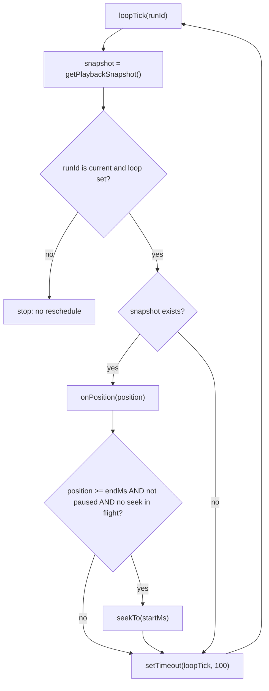
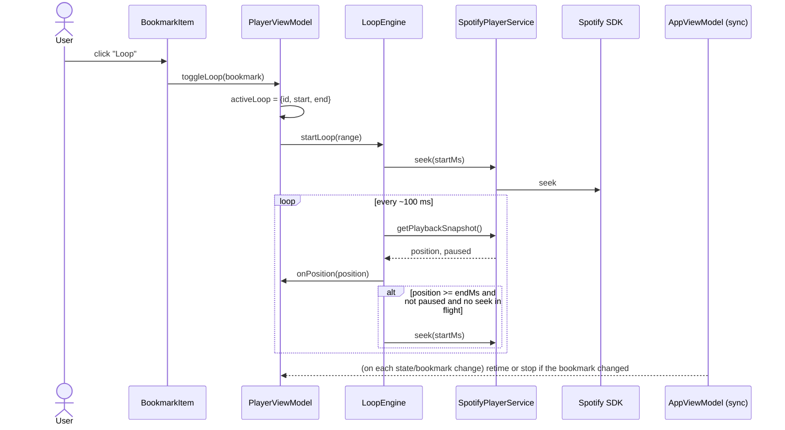

# 03 – Playing a bookmark in a loop

Files: `playback/LoopEngine.ts`, `viewmodels/PlayerViewModel.ts`, `viewmodels/AppViewModel.ts`, `viewmodels/BookmarkEditorViewModel.ts`,
`components/Bookmarks/BookmarkItem.svelte`.

A "loop" is a time range `{ startMs, endMs }` on the current track. Spotify has no native range-repeat, so the
app **polls the position and seeks back** when the end is reached.

## Concepts

- **`activeLoop`** in `PlayerState`: `{ id, startMs, endMs } | null`. At most one loop is active at a time.
- **`id`**: the bookmark's id for a loop started from a saved bookmark; `null` for an **editor preview** loop.
  This distinction drives the live-sync rules below.
- **`LoopEngine`** (`playback/LoopEngine.ts`) is a plain class that owns the timers and the position polling. It knows
  nothing about bookmarks or Svelte: it gets a `PlaybackSource` (snapshot + seek) and an `onPosition` callback.
  `PlayerViewModel` owns the *state* (`activeLoop`); the engine owns the *mechanics*.

## Starting and stopping

From the UI (`BookmarkItem.svelte`) the "Loop"/"Lukk" button calls `playerViewModel.toggleLoop(bookmark)`:

```
toggleLoop(loop):
  if state.activeLoop?.id === loop.id → deactivateLoop()
  else                                → activateLoop(loop)      # replaces any other active loop
```

### `activateLoop(loop, options?)`

1. `state.activeLoop = { id: loop.id ?? null, startMs, endMs }`.
2. `loopEngine.startLoop({ startMs, endMs }, options?.startFrom)`: cancels any previous loop poll, stops progress
   polling, seeks to `startFrom ?? startMs`, and schedules the first loop tick.

### `retimeActiveLoop(loop)`

Used when the active bookmark's range was edited. Updates `state.activeLoop` and calls `loopEngine.updateLoop(range)`.
It **does not seek**, so playback is not interrupted. Ignored if `loop.id` is not the active loop's id.

### `deactivateLoop()` and `deactivatePreviewLoop()`

`deactivateLoop` sets `activeLoop = null` and `loopEngine.stopLoop()` (progress polling resumes automatically if
playing). `deactivatePreviewLoop` does the same but only when the active loop has `id === null`; the editor uses it so
it can never tear down a bookmark loop.

Playback itself is not paused or seeked on deactivation; the track continues from where it is.

## The loop engine



Implementation notes:

- Each tick schedules the next only after its own `await`, so ticks never overlap even if the SDK is slow.
- **Run ids**: `startLoop` and `stopLoop` increment `loopRunId`. A tick that was mid-`await` when the loop was replaced or
  stopped sees a stale id and exits without seeking or rescheduling, so there is never more than one poll chain.
- The loop range is read from the engine's current `loop` on every tick, which is what lets `updateLoop` change bounds
  without restarting the poll.
- **Seek guard**: `isSeekInFlight` is true from the call to `seek` until its promise settles; no further loop seek is issued
  meanwhile. This prevents duplicate seeks when a seek takes longer than one tick. Seek failures are caught and logged
  (`console.warn`) and do not stop the loop.
- **Paused**: the poll keeps updating the position while paused but never seeks, so pausing past the end does not
  generate seeks. On resume with the position still beyond the end, the next tick seeks back.
- **No state**: a `null` snapshot (SDK momentarily has no state) skips enforcement for that tick; polling continues.
- Precision: the check runs every ~100 ms, so playback can overshoot `endMs` by roughly 100 ms plus seek latency before jumping
  back. The loop is practice-grade, not sample-accurate.
- The first tick can read the position before the initial seek has landed; if the playhead was past `endMs` it seeks to
  `startMs` again, which the seek guard keeps idempotent.

## Live synchronisation with bookmarks

`AppViewModel.start()` subscribes to the combination of `playerState` and `sortedBookmarks`. On every change:

```
if activeLoop is null or activeLoop.id is null → do nothing                # no loop, or an editor preview
bookmark = bookmarks.find(id == activeLoop.id)
if not found                                    → deactivateLoop()          # bookmark deleted
else if range differs from activeLoop           → retimeActiveLoop(bookmark) # bookmark edited, no seek
else                                            → nothing
```

Effects:

| User action | Result |
| --- | --- |
| Delete the bookmark that is looping | Loop stops, normal progress polling resumes |
| Edit and save the looping bookmark's start/end | New bounds apply on the next tick; playback is **not** interrupted or re-seeked (if the playhead is now past the new end, it jumps to the new start) |
| Edit only the name | Range equal → loop untouched |
| Switch track (`playTrack` succeeds, or the SDK reports a different track) | `activeLoop` cleared and engine stopped; `showBookmarksForTrack` loads the new track's bookmarks |
| `playTrack` fails | Previous track and loop are kept |

The subscription fires on every position update (every 100 ms during a loop). It is cheap: a lookup and comparison.

## Editor preview loops

While authoring a bookmark in `BookmarkEditorViewModel`, changing start or end schedules a **preview**:

- Debounce 500 ms (`schedulePreview` clears any pending timer first).
- Skipped if `startMs >= endMs`.
- Calls `player.activateLoop({ startMs, endMs }, options)` with **no id** → `activeLoop.id === null`.
- Changing the **start** previews from `startMs`; changing the **end** previews from `max(0, endMs − 2000)` so you hear the
  last two seconds leading into the new end point.

**Lifecycle.** The editor's `reset()` (used by cancel, successful submit, and automatic resets) cancels the pending timer
**and** calls `player.deactivatePreviewLoop()`, so a preview never outlives the form that created it. `beginEditing`
does the same before loading another bookmark. Because `deactivatePreviewLoop` only acts on `id === null` loops, a
running bookmark loop is never affected. Live sync ignores preview loops for the same reason.

**Automatic resets.** The editor subscribes (for the lifetime of the ViewModel) to:

- the **current track id**: when it changes, the form is reset, which also cancels a pending preview, so a preview scheduled
  on the old track can never fire on the new one;
- the **bookmark list**: if the bookmark being edited disappears (deleted, or the list switched to another track), edit mode
  is left and the form reset, so `submit()` can never try to update a bookmark that no longer exists.

## Sequence: start a saved loop



## UI feedback

- `BookmarkItem`: active when `$playerState.activeLoop?.id === bookmark.id`; shows play/pause and a restart button
  (`seek(startMs)`), and the button toggles to "✕ Lukk".
- `PlayerControls`: shows "🔁 Loop: m:ss – m:ss" and the green overlay on the seek bar from `loopRegion`.
- Previews show the overlay and header text too, but no bookmark row is highlighted (id is null).
