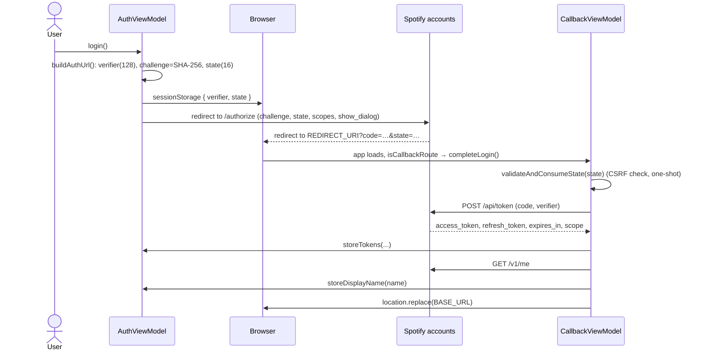

# 05 – Authentication and Spotify API

Files: `spotify/auth.ts`, `spotify/authPersistence.ts`, `services/SpotifyAuthService.ts`,
`services/SpotifyApiService.ts`, `viewmodels/AuthViewModel.ts`, `viewmodels/CallbackViewModel.ts`.

## Login (OAuth 2.0 Authorization Code with PKCE)

No client secret exists; only `VITE_SPOTIFY_CLIENT_ID` (baked into the bundle) and `VITE_REDIRECT_URI`.

- Scopes: `user-read-private user-read-email playlist-read-private playlist-read-collaborative streaming
  user-read-playback-state user-modify-playback-state`.
- `sessionStorage` keys `spotify_code_verifier` / `spotify_auth_state` exist only for the round trip. The verifier
  is removed after a successful token exchange; the state is removed when validated (whether or not it matches).
- Errors (`?error=…`, missing code, state mismatch, failed exchange) set `callbackState.error` and the page shows
  the message with a link home instead of redirecting.

## Token storage and refresh

`AuthViewModel` holds `authState { accessToken, refreshToken, expiresAt, displayName }` and persists every change
to `localStorage` (`spotify_access_token`, `spotify_refresh_token`, `spotify_expires_at`,
`spotify_display_name`; plus `spotify_debug_scopes`).

`getValidToken()` is the **only** way the app obtains a token:

1. No access token → `null`.
2. Not within 60 s of expiry → return it.
3. Near/after expiry with no refresh token → `logout()`, `null`.
4. Otherwise `POST /api/token` with `grant_type=refresh_token`; store the new tokens (keeping the old refresh token
   if Spotify does not return a new one) and return the new access token. Any failure → `logout()`, `null`.

`isAuthenticated` is derived from `accessToken` being non-empty. `logout()` clears memory and `localStorage`
(not bookmarks). Refresh is lazy: it happens on the next API call or SDK token request, not on a timer.

## Web API usage (`SpotifyApiService`)

Constructed with a token provider function. Every request awaits the provider and throws `Not authenticated` if it
returns `null`.

| Method | Endpoint |
| --- | --- |
| `getCurrentUser` | `GET /v1/me` |
| `getUserPlaylists` | `GET /v1/me/playlists?limit=50` |
| `getPlaylistTracks(id)` | `GET /v1/playlists/{id}/items?limit=100` (keeps only items with `album` and `artists`) |
| `startPlayback(deviceId, uri)` | `PUT /v1/me/player/play?device_id=…` body `{ "uris": [uri] }` |

Error handling: for non-OK responses the JSON `error.message` is used if present, otherwise the raw body, otherwise
`HTTP <status>`; read failures are also logged with `console.error`.

**Pagination.** `getUserPlaylists` and `getPlaylistTracks` follow the response's `next` link until it is `null`, up to 50
pages, and concatenate the items (track filtering is applied per page). A `next` URL is only followed when it starts with
`https://api.spotify.com/v1/`, so the bearer token is never sent to another host. An error on any page rejects the whole call.

## Spotify SDK loading

`spotify/sdk.ts` injects `https://sdk.scdn.co/spotify-player.js` once (memoised promise) and resolves when the
global `onSpotifyWebPlaybackSDKReady` fires. If the script fails to load, the promise rejects and the memo is cleared, so the
next attempt (the player's "Prøv igjen" button) injects the script again. The SDK is therefore a runtime script, not an npm dependency, and
requires a Premium account.
